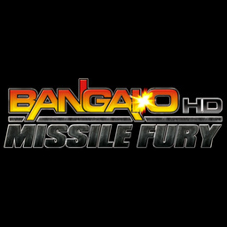

<h1 align=center>Bangai-O HD: Missile Fury — Nintendo Switch port</h1>

<b>bangaio-nx 1.0.1</b> · <a href="https://chanseyisthebest.github.io/bangaio-nx-installer/">web installer</a> · <a href="https://github.com/ChanseyIsTheBest/bangaio-nx/releases/tag/v1.0.1">release</a>

An unofficial native port of the Xbox 360 (Xbox Live Arcade) version of **Bangai-O HD: Missile Fury** (title
`58410AF2`), made by static recompilation with [ReXGlue](https://github.com/rexglue/rexglue-sdk) and drawn by Renut's
renderer on deko3d. No emulator.

This repository contains no game files. You need your own copy of the game: its Xbox Live Arcade package from an
Xbox 360 (`Content/0000000000000000/58410AF2/000D0000/`). The game has no title update.

## Playing it on the Switch

1. Open the web installer: **https://chanseyisthebest.github.io/bangaio-nx-installer/**
   ([its source](https://github.com/ChanseyIsTheBest/bangaio-nx-installer)).
2. Give it your package or the folder you extracted it to and press **Create bangaio-nx.zip**. It makes the shaders in
   your browser; nothing is uploaded.
3. Extract `bangaio-nx.zip` to the root of your SD card and start `switch/bangaio-nx/bangaio-nx.nro` from the Homebrew
   Menu with a title takeover (hold R while starting a game).

Features:

- Native Switch renderer (Renut's, on deko3d). Handheld 1280x720; docked drawn at 1600x900 and shown at 1920x1080
  (`docked_resolution = 1080` for everything at 1080).
- SMAA edge smoothing on the playfield (`smaa`, on by default).
- English, Japanese or French (`language`).
- Logging off; only `logs/rex/rex_stderr.log` is kept, for crash reports.

Your options are in `switch/bangaio-nx/renut.toml`; everything else is built into the NRO.

## Building

Both builds need the code generated from your own `default.xex`, which is not in this repository.

1. Generate the code: ReXGlue's codegen with `app/config/` (`tools/codegen.ps1`).
2. Switch: `tools/build_switch.bat` (devkitA64; PGO + LTO for the release).
3. PC: `tools/build_pc.bat` (reNut's renderer on Vulkan).

The release NRO's shader table is empty (`tools/renut_switch_shader_cache.py --only` on an empty folder); it reads the
shaders the installer makes. Notes in `docs/`.

## Credits and license

- [ReXGlue](https://github.com/rexglue/rexglue-sdk) (the recompiler and runtime) and its Discord.
- reNut's renderer ([reNut](https://github.com/masterspike52/reNut)) by masterspike52, who permits its reuse in these
  ports; SolarCookies (mid-asm hooks, the reNut launcher), ValcomDrifty, OlieGamerTV.
- banjo-nx (this port's base), nights-nx (the hook pairing tools, the installer), sa2-nx (input, CPU work),
  peggle2-nx, bejeweled3-nx and the Zuma ports (frame pacing, the hot-function method, the Direct3D tools).
- kameo-nx and the Torchlight port (game memory and the NRO's code on 2 MB blocks).
- battd_nx (the GPU arena).
- SMAA by Jorge Jimenez et al. (MIT).

GPL-3.0 where the sources are ([LICENSE](LICENSE)). Bangai-O HD: Missile Fury is (c) Treasure Co., Ltd.; this project
is not affiliated with Treasure.
